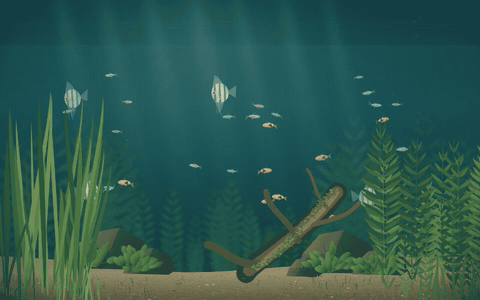
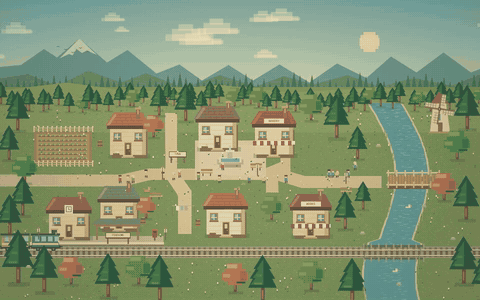

# 壁纸盒子 · Wallpaper Box

一款 Web 壁纸管理程序，将水族箱、像素小镇等动态壁纸带到 Windows 桌面。支持多显示器、离线播放与点击互动。

**[下载 Windows x64 安装版](https://github.com/whoarei/wallpaper-box/releases/latest)** · [更新记录](https://github.com/whoarei/wallpaper-box/releases)

## 效果预览

| 静水之间 | 松风镇 |
| :---: | :---: |
|  |  |
| 水草、光影与鱼群，点击水面投喂。 | 林间小屋与小火车，点击草地种花。 |

点击动图可观看 **10 秒演示视频**。

## 功能亮点

- **壁纸专属设置**：选择已安装壁纸定制效果，每张壁纸在设备上共用一份配置；运行时同步，未运行时下次启动生效。

- **中英双语**：支持跟随系统、简体中文与 English，托盘、内置壁纸和预览同步切换，无需重新加载。
- **多屏独立设置**：通过缩略图选屏，为每块显示器选择不同壁纸，支持竖屏，自动避开任务栏。
- **离线播放与自动暂停**：已安装壁纸可离线使用，遮挡时自动暂停，支持托盘控制。
- **自绘托盘菜单**：显示当前屏幕壁纸与播放状态，设置、更新和关于直接访问，支持键盘导航。
- **自绘窗口控件**：标题栏与导航融合，支持最大化 / 还原、拖拽、键盘操作及收起到托盘。
- **静默随系统启动**：默认在登录后恢复壁纸并驻留托盘，可在“设置 → 常规”关闭。
- **按需添加壁纸**：从“发现”下载喜欢的内容或切换历史版本，最多 5 项并行；支持导入文件夹或 ZIP。
- **仓库与代理设置**：默认使用 Gitee，支持 GitHub/Gitee 自定义仓库和独立开关；网络默认跟随系统代理。
- **资源占用可见**：底部显示当前屏幕壁纸的 CPU、内存占用，每 5 秒采样，收起或最小化后停止采样。
- **程序在线升级**：后台下载并验证，由你决定何时重启升级，保留壁纸与多屏设置。

## 开始使用

1. 下载安装版，运行 `wallpaper-box.exe`。
2. 点击右上角的显示器缩略图，再点击壁纸封面应用。
3. 底部播放栏可暂停、继续，并执行壁纸提供的互动操作；导入壁纸、程序更新和关于信息位于“设置”。

支持 **Windows x64**，需要 WebView2，安装程序会在缺少时自动下载。

**v0.13.0** 更新托盘右键菜单：浅绿圆角、细线图标、分组与当前播放状态；设置、自动暂停、程序更新和关于可从一级菜单直达。移除显示 / 还原桌面功能，保留壁纸与多屏设置。

[详细使用与开发说明](docs/guide.md) · [默认 Gitee 壁纸库](https://gitee.com/xishuaiya/wallpapers) · [GitHub 壁纸库](https://github.com/whoarei/wallpapers)

网页壁纸开发者请参考 [壁纸适配规范（Markdown）](docs/wallpaper-adaptation.md)，包含运行模式、输入、暂停、可选操作接口，以及完整示例。主程序从 **v0.10.0** 起提供基础 v1 接口；旧内容包的基本播放与页面操作继续可用。从 **v0.12.0** 起新增的[壁纸设置通信扩展](docs/wallpaper-adaptation.md#可选壁纸设置通信)也已写入规范，包括配置读取、变更事件与设置页 SDK；壁纸通过设置能力检测接入，旧宿主采用默认配置。
